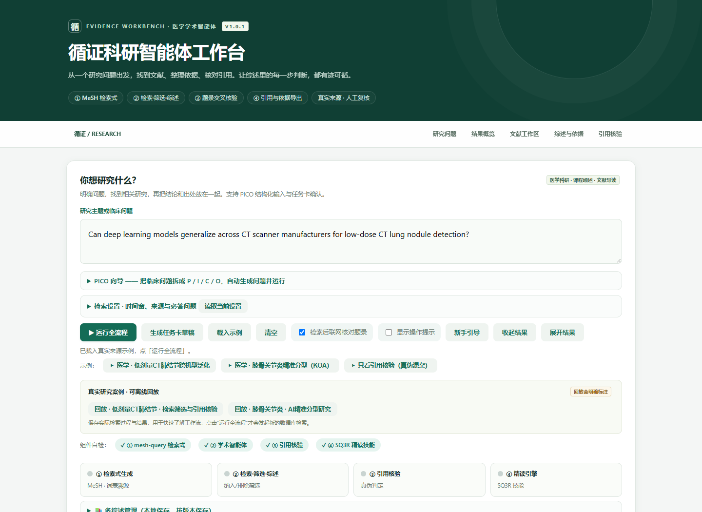
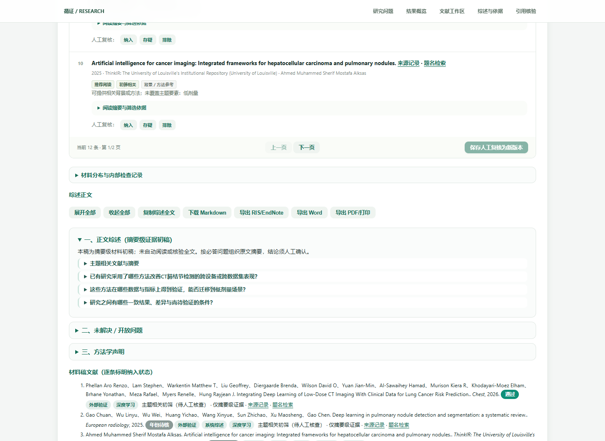

# 循证科研工作台 · Evidence Workbench

**从研究问题到可追溯的文献材料。Windows 桌面版 v1.0.1。**

为医学生、医学研究生和医工交叉研究者，把任务卡、真实文献检索、筛选判断、原有综述材料和引用依据放进同一个研究版本。



## 下载与使用

在本仓库的 **Releases → v1.0.1** 下载 `EvidenceWorkbench-1.0.1-windows-x64.zip`。

1. 解压整个文件夹，不要只拿出 `.exe`。
2. 双击 `EvidenceWorkbench.exe`，在独立桌面窗口中使用。
3. 首页可以打开两个标注为“真实案例回放”的医学案例；新检索需联网。

Windows 10/11 x64。无需安装 Python、Claude Code 或其他 AI CLI，也不需要模型账号或 API Key。界面使用 Microsoft Edge WebView2 Runtime；缺少时可从 [Microsoft 官方页面](https://developer.microsoft.com/microsoft-edge/webview2/)安装。联网即可进行新文献检索和题录核验，已保存案例可离线查看。

当前为未进行商业代码签名的便携发行包，Windows 显示的发布者可能为未知；下载后可按下文核对 SHA-256。

个人研究记录与浏览器状态保存到 `%LOCALAPPDATA%\EvidenceWorkbench`。更新时替换程序文件夹，保留这个用户数据目录。

## 功能

- 研究问题与 PICO 任务卡，表单编辑时间窗、来源和必答问题。
- MeSH 正式词核对，PubMed / OpenAlex / Semantic Scholar 实际查询留痕。
- 实际来源、批次与失败状态；自适应分页预算，默认推荐约 12 篇，目标范围 5—20 篇。
- 文献题名、摘要、DOI 搜索；系统初筛和人工纳入 / 存疑 / 排除理由。
- 保留原有按研究问题组织的综述材料、摘要原句和引用跳转；不调用本机编程助手另写正文。
- 外部题录核对、年份差异与请求失败分别呈现；未检出不等于造假。
- 新版本与原稿隔离；Markdown、Word 兼容 HTML、RIS、CSV、打印 / PDF 与 ZIP 证据包导出。
- 肺结节和膝骨关节炎两个已保存的真实案例，明确标注回放，不冒充实时结果。



## 能力范围

这是本地、单用户的摘要级研究辅助软件。原有综述流程按研究问题组织已检索文献的摘要材料；本版不提供额外的模型代写功能。规则初筛不等于阅读全文、医学偏倚评价或结论正确。当前不进行正式 GRADE / QUADAS 评级，不替代专业人员核查。

5—20 篇是推荐展示范围，分页停止是资源预算，不代表证据充足或系统综述检索完整。可用材料少或接口失败时返回实际情况。

## 源码运行

建议 Python 3.12。首先获取 MeSH 资源（数据库文件独立放在 Release 中，避免将 163 MB 文件写入 Git 历史）：

```powershell
python -m venv .venv
.venv\Scripts\python -m pip install -r requirements.txt
.venv\Scripts\python scripts/fetch_mesh.py --repo xym-325/evidence-workbench
.venv\Scripts\python run.py
```

词表资源继续固定在 v1.0.0 的 `mesh-2026.sqlite.gz`，脚本会自动获取。也可手动下载并执行 `python scripts/fetch_mesh.py --archive 路径`；脚本核对压缩包和数据库的 SHA-256。私有仓库可在已登录 GitHub CLI 后追加 `--authenticated`。

只启动本地网页服务：`python run.py --serve --port 8137`。

## 测试与构建

```powershell
.venv\Scripts\python -m pip install -r requirements-build.txt
.venv\Scripts\python scripts/build_windows.py
```

构建脚本先执行受控测试，再生成 Windows x64 便携包与 `SHA256SUMS.txt`。下载者可用 `Get-FileHash 文件.zip -Algorithm SHA256` 核对。冻结程序支持 `--self-test --report report.json`（本机后端和离线 MeSH 自检）及 `--smoke-test --report report.json`（隐藏原生 WebView2 窗口自检）。

GitHub Actions 在手动触发或发布 Release 后运行构建检验。首次 v1.0.0 使用本机验收后的安装包发布，MeSH 资源随同上传。

## 数据与依赖

MeSH 来自 NLM 官方词表；文献检索和核验来源见应用中的逐库记录。没有捆绑付费全文、私人研究记录或模型账号。第三方项目和授权说明见 [THIRD_PARTY_NOTICES.md](THIRD_PARTY_NOTICES.md)。本项目尚未另行授予开源许可，保留原作者权利。
